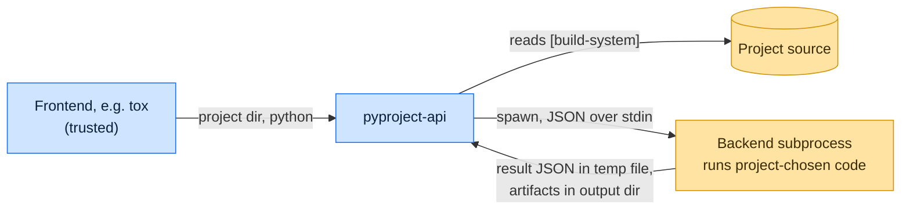

# Threat model

This model says what pyproject-api trusts, where untrusted input enters, and which guarantees hold at each boundary, so
a report can be classified as a vulnerability or a bug. [SECURITY.md](SECURITY.md) covers reporting; if the two
disagree, SECURITY.md wins and we fix this file.

## How pyproject-api works

A frontend such as tox points pyproject-api at a project folder. pyproject-api reads `[build-system]` from
`pyproject.toml`, checks that every `backend-path` entry stays inside the project, and starts the backend in a
subprocess of the interpreter the caller chose: `SubprocessFrontend` starts a fresh one per call, while other frontends,
such as tox's, can keep one alive across calls (`reuse_backend`). Each hook call (`build_wheel`,
`prepare_metadata_for_build_wheel` and so on) goes to the backend's stdin as JSON, and the backend writes its answer to
a temporary JSON file that the frontend reads back. Without a metadata hook, pyproject-api builds a wheel and extracts
its `.dist-info` into the caller's metadata directory.

## Compared with similar tools

We drew the boundary where comparable projects in other ecosystems draw theirs. The shared rule, stated by the
[Node.js threat model](https://github.com/nodejs/node/blob/main/SECURITY.md#the-nodejs-threat-model), is that a report
which first needs a trusted element compromised is out of scope; the first triage question, as
[DOMPurify](https://github.com/cure53/DOMPurify/blob/main/SECURITY.md#what-we-consider-a-vulnerability) puts it, is what
the attacker controls.

| Project                                                                             | Language   | Where it draws the line                                                                                                                                                  |
| ----------------------------------------------------------------------------------- | ---------- | ------------------------------------------------------------------------------------------------------------------------------------------------------------------------ |
| [Cargo build scripts](https://doc.rust-lang.org/cargo/reference/build-scripts.html) | Rust       | A package's `build.rs` runs with full rights during a build; building a crate means trusting it.                                                                         |
| [Hatch](https://github.com/pypa/hatch/security/policy)                              | Python     | Assumes the user has full control over the build environment.                                                                                                            |
| [pnpm](https://github.com/pnpm/pnpm/security/policy)                                | JavaScript | Draws its boundary at filesystem permissions: the store, project, lockfile and configuration are trusted, and running it in a repository means trusting that repository. |

## Trusted

An attacker who controls any of these already has what pyproject-api could give them:

- The frontend and the project folder, interpreter, environment and output directories it passes.
- The project's build backend and its `requires`; the backend runs with the user's rights.
- The filesystem and temporary directory.

## Untrusted inputs

| Input                                        | Comes from                          | What pyproject-api guarantees                                                                                                       |
| -------------------------------------------- | ----------------------------------- | ----------------------------------------------------------------------------------------------------------------------------------- |
| `build-system.backend-path`                  | The project's `pyproject.toml`      | Each entry must be relative and resolve inside the project; otherwise the call fails.                                               |
| Backend stdout and stderr                    | The backend and anything it imports | Captured and returned to the caller as text; hook results come only from the result file.                                           |
| Malformed `[build-system]`                   | The project's `pyproject.toml`      | Wrong types raise a `ValueError` naming the key; a missing table falls back to the legacy setuptools backend, as PEP 517 specifies. |
| Members of a built wheel                     | The backend                         | Only members under a top-level `.dist-info` directory are extracted, through `zipfile`'s path sanitizing.                           |
| Entries inside a metadata directory to clear | Earlier builds, or the backend      | Refused when it is the project root or one of its ancestors; symlinks inside it are unlinked, never followed.                       |

## Threats and controls

| STRIDE                 | Threat                                                                  | Control                                                            |
| ---------------------- | ----------------------------------------------------------------------- | ------------------------------------------------------------------ |
| Tampering              | `backend-path = ["../other"]` loads a backend from outside the project. | Entries outside the project are rejected.                          |
| Spoofing               | Backend output printed to stdout is taken as a hook's result.           | Results travel through a per-call temporary JSON file, not stdout. |
| Elevation of privilege | A backend runs code during a build.                                     | Accepted by design; PEP 517 builds run the project's code.         |

## Release chain

Releases run on the shared [tox-dev/github-workflows](https://github.com/tox-dev/github-workflows) pipeline. A release
App, not a person, pushes the release commit and tag; the build installs its tools from a hash-checked `pylock.toml`
resolved with a seven-day upload cooldown by default; PyPI receives the files through
[trusted publishing](https://docs.pypi.org/trusted-publishers/) with attestations, and the GitHub Release is immutable.
Every workflow pins third-party actions to a commit SHA.

## Vulnerability or bug

| Report                                                               | Verdict                                              | Why                                                          |
| -------------------------------------------------------------------- | ---------------------------------------------------- | ------------------------------------------------------------ |
| `backend-path` with `../` imports a module from the parent directory | Vulnerability                                        | The in-tree guarantee of PEP 517 is broken.                  |
| Building a malicious sdist runs its `setup.py`                       | Not a vulnerability                                  | The backend is trusted; build untrusted source in a sandbox. |
| A backend that prints JSON confuses `get_requires_for_build_wheel`   | Bug, or vulnerability if the result file is bypassed | Results must come only from the result file.                 |

## Severity

- **High:** a frontend call deletes or writes outside the directory the caller named, or clearing a metadata directory
  removes the project or follows a symlink inside it.
- **Medium:** a `backend-path` outside the project is accepted, a hook's returned path escapes its directory, or one
  call's result is read as another's.
- **Low:** a malformed backend response crashes or hangs the frontend instead of failing with an error.

## Accepted risks

- Every hook call runs project code; isolation from the host is the caller's job.
- The backend subprocess inherits the environment the caller passes, secrets included.

## Keeping this current

Revisit this model when pyproject-api gains a new input source, network access, a new way to run code, or a new place it
writes to, and whenever an advisory is published.
